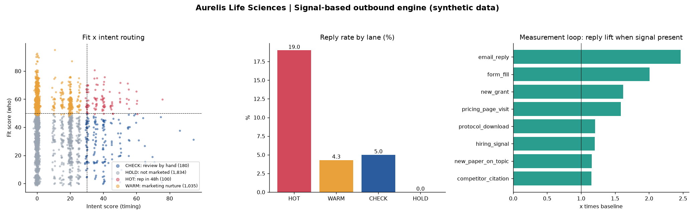
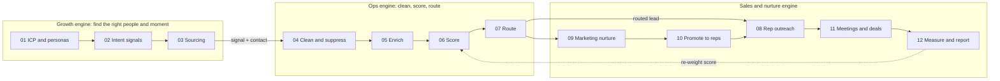

# 01 | Signal-Based Outbound GTM Engine

**Status: In progress (design complete, build rolling out in stages)** · Fictional company: Aurelis Life Sciences · **All data is synthetic**



## The problem
Outbound ran as volume: large sequence blasts to imported lists, a few percent reply rate, no written ICP, an engagement-only lead score with no "fit" side, and no rule for when a warm contact should go to a rep. Sending more did not produce more meetings.

## The idea
Copy a proven signal-based GTM model and adapt it to a small team with a niche product and a long, scientific buying cycle. Use tools already in the stack, add no new software, and build each piece next to the old one before switching over.

**Principle:** fit decides *who*, intent decides *when*. Good-fit contacts with a live signal go to a rep within 48 hours. Good-fit contacts without a signal go to nurture and come back when a signal fires.

## Architecture
Three engines joined by two handoffs, owned end to end by one GTM engineer.



## Routing: fit x intent
| | **Intent now** | **No signal yet** |
|---|---|---|
| **High fit** | **HOT**: rep emails within 48h with a signal-based opener | **WARM**: marketing nurture by product until a signal fires |
| **Low fit** | **CHECK**: reviewed by hand each week | **HOLD**: stays in the CRM, never marketed |

See [diagrams/routing_matrix.md](diagrams/routing_matrix.md) and [diagrams/lead_journey.md](diagrams/lead_journey.md).

## What the synthetic run shows (4,000 contacts)
| Step | Result |
|---|---|
| Raw contacts | 4,000 |
| Removed before scoring | 851 (469 duplicates, 263 small-company rule, 119 competitor domains) |
| Scored and routed | 3,149 |
| HOT / WARM / CHECK / HOLD | 100 / 1,035 / 180 / 1,834 |
| Reply rate | HOT 19.0%, CHECK 5.0%, WARM 4.3% |

The point is not the absolute numbers, which are simulated. It is the design: targeted lanes outperform blanket sends, and the measurement loop shows which signals lift replies so score weights can be re-tuned monthly.

## Documents
| Doc | Contents |
|---|---|
| [docs/icp_and_personas.md](docs/icp_and_personas.md) | ICP card template and example for one segment |
| [docs/signal_catalog.md](docs/signal_catalog.md) | Intent signals, sources, points, how each is used |
| [docs/scoring_model.md](docs/scoring_model.md) | Fit and intent scoring, thresholds, decay, re-weighting |
| [docs/guardrails.md](docs/guardrails.md) | Suppression rules, send pacing, stop rules, data ownership |
| [docs/rollout_plan.md](docs/rollout_plan.md) | Four-week build and go-live sequence |

## Reproduce
```bash
pip install pandas numpy matplotlib
python scripts/score_and_route.py   # writes data/*.csv and charts/engine_overview.png
```

## What is built vs planned
| Piece | State |
|---|---|
| Blueprint, tool map, routing logic, guardrails | Done |
| Fit and intent scoring prototype (this repo) | Done, synthetic |
| CRM fit score, routing workflows, nurture tracks | Rolling out, built switched off and tested on a few contacts first |
| AI-drafted openers reviewed by reps | Planned |
| Monthly re-weighting from outcomes | Planned |

## Skills shown
GTM strategy · ICP and segmentation · signal and intent design · lead scoring · routing and SLAs · outbound sequencing discipline · funnel measurement · RevOps process design
