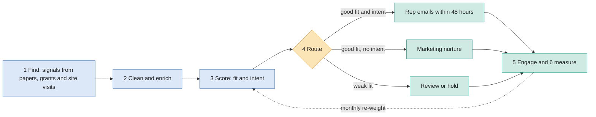

# Lead journey: signal to sale in six boxes

How to read it: find people with a reason to buy, clean and score them, send each to the right route, and use results each month to improve the score.

Full detail with every connection: [lead_journey_full_detail.md](lead_journey_full_detail.md).
