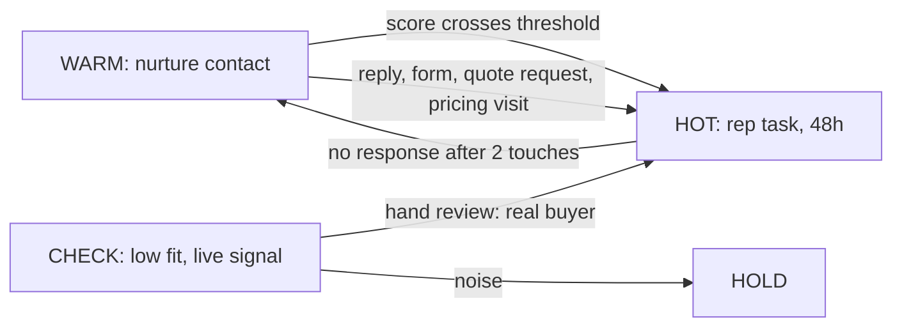

# Routing: fit x intent

```mermaid
quadrantChart
    title Where each contact goes
    x-axis Low intent --> High intent
    y-axis Low fit --> High fit
    quadrant-1 HOT: rep in 48h
    quadrant-2 WARM: nurture by product
    quadrant-3 HOLD: not marketed
    quadrant-4 CHECK: review by hand
    Pricing visit, PI at organ-on-chip co: [0.85, 0.85]
    New paper, scientist in target area: [0.3, 0.8]
    Student downloads protocol: [0.7, 0.25]
    Generic contact, no signal: [0.15, 0.2]
```

## Promotion loop


