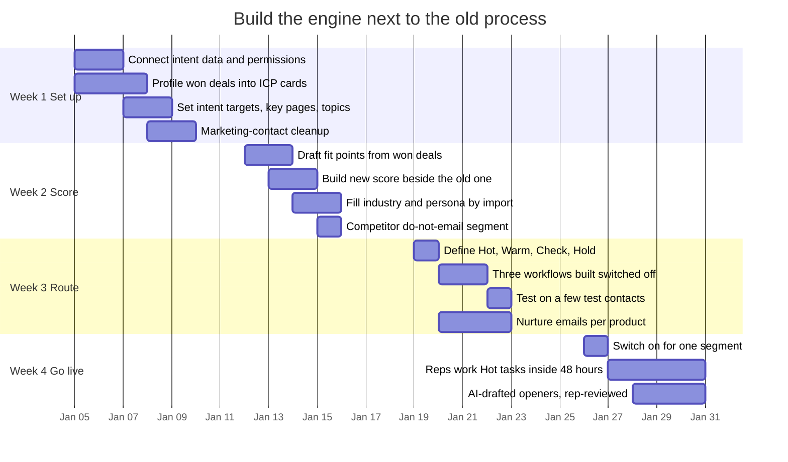

# Rollout plan (four weeks, no sandbox)

Done when: week 1 intent is readable and ICP cards exist; week 2 the new score ranks past buyers above non-buyers; week 3 each test contact lands in the right lane; week 4 the first Hot leads have a rep reply logged.

**Cadence after go-live:** every Monday the Hot and Check lists go to the team; every month a funnel by product and source goes to leadership and the score is re-weighted. Segments two and three follow, and any paid data or enrichment tool is decided from pilot results.
