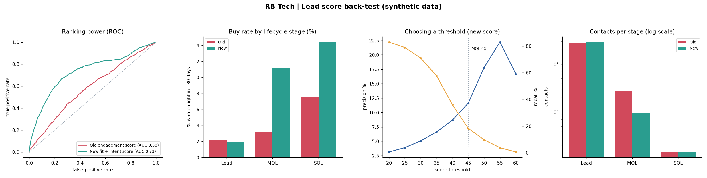
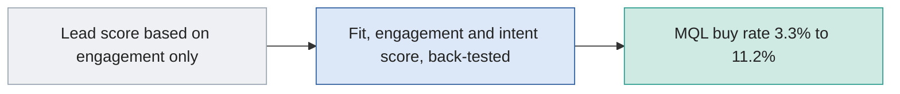

# 02 | Lead Scoring Redesign: From Engagement-Only to Buy-Readiness

**Fictional company:** RB Tech · **All data is synthetic**



## At a glance


## The problem
MQL and SQL were defined purely by an engagement score: **MQL at 15 points, SQL at 30**. The score counted opens, any form fill, any page visit, and even the team's own actions (enrolling a contact in a sequence, calling them). It had no notion of **who** the contact was. Results:
- Opens are inflated by security scanners, and own actions score points that say nothing about the buyer.
- A newsletter form counts the same as a quote request; a blog visit the same as a pricing-page visit.
- It only separated buyers from non-buyers above about 20 points; below that, conversion was flat.
- Real buyers (programme buyers met at events, customers with no recent activity) scored near zero.

## What I built
1. **A fit + engagement + intent score (0-100)** with a documented split: company fit 30, contact fit 25, engagement 25, intent 20, plus hard rules (competitors, tiny companies and student-only contacts score zero).
2. **New lifecycle definitions** that combine fit and timing instead of engagement alone ([docs/lifecycle_definitions.md](docs/lifecycle_definitions.md)).
3. **A back-test** that scores 30,000 synthetic contacts both ways against who actually bought in 180 days.
4. **A threshold method** that picks cut-offs from precision, recall and sales capacity rather than by feel ([docs/revision_playbook.md](docs/revision_playbook.md)).

## Results on the synthetic back-test
| | Old: engagement only | New: fit + engagement + intent |
|---|---|---|
| Ranking power (AUC) | 0.58 | 0.73 |
| MQL: contacts / buy rate | 2,696 / 3.3% | 937 / 11.2% |
| SQL: contacts / buy rate | 145 / 7.6% | 146 / 14.4% |
| Lead (not qualified): buy rate | 2.2% | 1.9% |

Fewer contacts are labelled MQL, but they convert more than three times as often, and conversion now rises at every stage (Lead, MQL, SQL), which is what a lifecycle model should do. The numbers are simulated; the method is what carries over.

**Threshold trade-off (new score):** a lower MQL cut-off finds more of the eventual buyers but fills nurture with weaker leads. For example, a cut-off of 40 recalls about 36% of buyers at 8.7% precision, while 50 recalls about 10% at 17.8% precision. The right point depends on how many leads sales and marketing can handle well.

## Design decisions
1. **Fit decides who, intent decides when, engagement shows interest.** Three signals, one number, separate parts you can inspect.
2. **Hand-raises skip the formula** (reply, quote or sample request, pricing-page visit, meeting booked) but a hand-raise from a poor-fit contact goes to hand review rather than straight to a rep.
3. **Count what the contact does, not what we do.** Remove points for sequence enrolment and our own calls; count clicks and replies instead of opens.
4. **Weight actions by meaning.** A quote form is worth far more than a newsletter form; a pricing visit more than a blog visit.
5. **Hard rules before points.** Competitors, tiny companies and students never become MQL.
6. **Deal value belongs in the account tier, not the score.** Large deals often come from programme buyers who score low on individual contact features, so account priority is handled separately.
7. **Build next to the old score, compare, then switch.** The old score keeps running until the new one is proven on real data.

## Documents and diagrams
- [docs/lifecycle_definitions.md](docs/lifecycle_definitions.md): old and new MQL, SQL and hand-raise rules
- [docs/revision_playbook.md](docs/revision_playbook.md): how to revise a score, step by step
- [docs/score_components.md](docs/score_components.md): points for each component
- [diagrams/lifecycle_flow.md](diagrams/lifecycle_flow.md)

## Reproduce
```bash
pip install pandas numpy matplotlib
python scripts/scoring_backtest.py   # writes data/*.csv and charts/scoring_backtest.png
```

## Skills shown
Lead scoring and lifecycle design · model back-testing (AUC, precision, recall) · threshold calibration against capacity · funnel definition · data-driven GTM operations · Python
