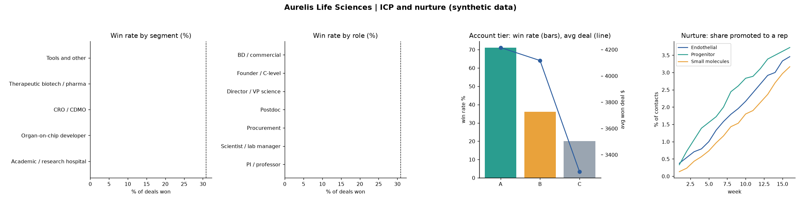

# 03 | ICP, Account Tiers and Nurture Tracks

**Fictional company:** Aurelis Life Sciences · **All data is synthetic**



## The problem
Outbound targeting rested on assumptions: nobody had written down who actually buys, which roles close, or how big the buyer's organisation tends to be. Contacts from every segment were treated alike, there was no tiering of accounts, and good-fit contacts who were not ready to buy had nowhere to go, so they either received sales sequences too early or were forgotten.

## What I built
1. **Won-deal profiling.** Every closed deal (360 in the synthetic set) is profiled by segment, role, organisation size and product to see win rate and deal value for each ([data](data)).
2. **ICP cards** for the strongest segments, each with who buys, why, buyer personas, triggers, disqualifiers and the best first product ([docs/icp_cards.md](docs/icp_cards.md)).
3. **Account tiers A, B and C** built from segment, role and size points, validated against win rate and deal size.
4. **Three product nurture tracks** (endothelial, progenitor, small molecules) with entry, engagement, promotion and exit rules ([docs/nurture_tracks.md](docs/nurture_tracks.md)).

## What the data shows
| Finding | Evidence |
|---|---|
| Two kinds of buyer: **lab buyers** (academic labs, $1-5K, quick decisions) and **programme buyers** (therapeutic and organ-on-chip developers, larger deals) | Average won deal about $2.3K for academic labs vs about $9.2K for organ-on-chip developers |
| Role matters as much as segment | PIs and lab scientists win far more often than business-development or founder contacts |
| Larger organisations win more; the smallest convert least | Win rate rises from the 1-10 band to the 5K+ band |
| Tiers predict outcomes | Tier A wins 71% of deals, Tier B 36%, Tier C 20% |
| Nurture works slowly and cheaply | About 3-4% of nurtured contacts reach a promotion trigger within 16 weeks, with no rep time spent |

## Design decisions
1. **Build the ICP from won deals, not from opinion**, and re-check every quarter as deals accumulate.
2. **Separate lab buyers from programme buyers.** They need different messages, speed and owners, and deal size belongs in the account tier rather than in the contact score.
3. **One decision-maker plus at most one escalation contact per account.**
4. **Nurture by product**, so a contact interested in endothelial cells does not get small-molecule emails.
5. **Promotion on behaviour**: a hand-raise or enough engagement points moves a contact to a rep; no engagement for ten weeks moves them out.
6. **Marketing owns entry and exit rules**, so nurture does not grow into a dumping ground.

## Documents and diagrams
- [docs/icp_cards.md](docs/icp_cards.md) · [docs/account_tiers.md](docs/account_tiers.md) · [docs/nurture_tracks.md](docs/nurture_tracks.md)
- [diagrams/icp_to_nurture.md](diagrams/icp_to_nurture.md)

## Reproduce
```bash
pip install pandas numpy matplotlib
python scripts/icp_and_nurture.py     # writes data/*.csv and charts/icp_nurture_overview.png
```

## Skills shown
ICP development · win/loss analysis · account tiering · persona design · nurture programme design · promotion and exit rules · segmentation · Python
