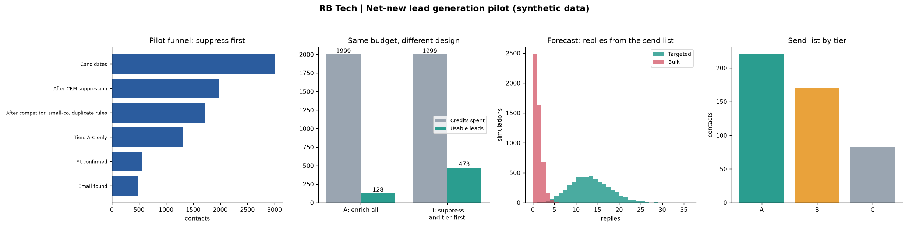

# 04 | Net-New Lead Generation Pilot: Suppress First, Tier First, Enrich Last

**Fictional company:** Aurelis Life Sciences · **All data is synthetic**



## The problem
The existing process for finding new contacts was keyword pulls from a contact database, an email verifier, bulk e-blasts, then reps emailing people who opened. Most contacts were already in the CRM, many were competitors or tiny companies, replies were rare, and every enrichment step costs money. The goal of the pilot: test whether a data-enrichment platform plus free scientific sources can produce **net-new, high-fit contacts** that reps and e-blasts have not already reached, and measure the real cost per lead and per reply.

## Pilot design
1. **Free sourcing first.** Company and people searches plus public scientific sources (papers, grants, lab pages) cost nothing and give the candidate list.
2. **Suppress before spending.** Check every candidate against the CRM (email, name, domain) and drop existing contacts, competitors, tiny companies and duplicates. No enrichment credits are spent on anyone who would be dropped anyway.
3. **Tier with free signals.** Tier A (uses a competitor product or works on our exact topic), B (adjacent), C (possible), D (low relevance, dropped).
4. **AI fit check only where it adds value:** tiers B and C. Tier A is accepted on free evidence.
5. **Measure real cost on a 10-row test** before any large run. Switch off auto-run on every enrichment column.
6. **Enrich emails in priority order** (A first) until the budget is spent, then verify.
7. **Send from the CRM**, tag every lead by source, keep it out of mass e-blasts for 30 days, and compare against the existing process on fresh-contact share, bounce rate, positive replies, meetings and cost per meeting.

## Results on the synthetic run (3,000 candidates, 2,000-credit budget)
| | A: enrich everything, filter later | B: suppress first, tier first |
|---|---|---|
| Credits spent | 1,999 | 1,999 |
| Usable leads (right fit, email found, not suppressed) | 128 | **473** |
| Of which Tier A | 41 | **220** |
| Credits per usable lead | 15.6 | **4.2** |

**Forecast for the send list (Monte Carlo, 5,000 runs):** about 13 positive replies from the targeted, tiered send (10th-90th percentile 7-19) versus fewer than 1 from a bulk send of the same size. Targeted sending is judged on positive replies, not opens.

## Design decisions
1. **Order the funnel by cost:** free steps first, paid steps last, only on what survives.
2. **Suppression is a hard gate.** No lead enters a sequence if it is already in the CRM; re-check on the day of import.
3. **Small trial, then scale.** Measure per-action cost on 10 rows; per-lookup cost is usually higher than the vendor's headline rate.
4. **Do not let a tool sync into the CRM automatically.** Import approved files only, with a lead source tag.
5. **Send only from the CRM**, never from the enrichment tool's own sender.
6. **Stop rule:** if the reply rate stays under 1% after 500 sends, pause and fix targeting or message before sending more.
7. **A person approves any spend.** Estimate credits first, then run.

## Related project
The tool layer that runs these steps with an AI assistant over MCP is in [RevOps-Portfolio 18](https://github.com/rbanola1/RevOps-Portfolio/tree/main/18-ai-scientific-prospecting-mcp).

## Documents and diagrams
- [docs/pilot_design.md](docs/pilot_design.md) · [docs/cost_control.md](docs/cost_control.md) · [docs/measurement_plan.md](docs/measurement_plan.md)
- [diagrams/pilot_funnel.md](diagrams/pilot_funnel.md)

## Reproduce
```bash
pip install pandas numpy matplotlib
python scripts/pilot_model.py    # writes data/*.csv and charts/pilot_overview.png
```

## Skills shown
Lead generation design · data suppression and deduplication · cost control · experiment design and Monte Carlo forecasting · enrichment workflow design · outbound measurement
