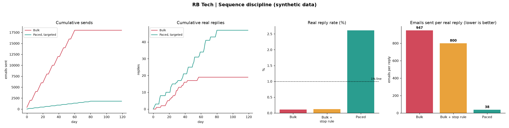
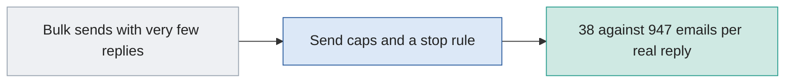

# 05 | Sequence Design and Send Discipline

**Fictional company:** RB Tech · **All data is synthetic**



## At a glance


## The problem
Outbound ran as mass enrollment: thousands of contacts enrolled in a sequence at once, far beyond the daily send limit, so a "launch" took weeks to finish and nobody could say which message worked. Replies counted auto-replies, opens were inflated by security scanners, and the reply rate was a fraction of a percent. Competitor staff and existing customers sat in the lists. Meanwhile a small, targeted sequence sent by hand got several percent replies.

## What I built
A set of rules and a simulation that shows the effect of operating style on results:

| Piece | What it does |
|---|---|
| **Sequence template** | Three steps, short copy, a real signal in the first line, a clear single ask ([docs/sequence_design.md](docs/sequence_design.md)) |
| **Pacing rules** | Daily send caps per sender, sends on set weekdays, enrol in small batches, never exceed what drains in a week ([docs/pacing_and_deliverability.md](docs/pacing_and_deliverability.md)) |
| **Stop rule** | If the real reply rate is under 1% after about 500 sends, pause, revise the list or message, then resume |
| **Clean measurement** | Count real replies only (exclude auto-replies, out-of-office, unsubscribes), and clicks over opens ([docs/measurement.md](docs/measurement.md)) |
| **Suppression** | Competitors, customers, open deals, small-company exclusions and existing sequence members are blocked before enrolment |

## Results on the synthetic run
| Style | Contacts | Emails sent | Days to finish | Real reply rate | Real replies | Sends per real reply |
|---|---|---|---|---|---|---|
| Bulk, mass enrollment | 6,000 | 18,000 | about 60 | 0.11% | 19 | 947 |
| Bulk with the stop rule | 6,000 | 800 (paused) | stops on day 1 | 0.12% | 1 | 800 |
| Paced, targeted, signal-based | 600 | 1,800 | about 80 | 2.6% | 47 | **38** |

**Reading it:** the paced style sends one-tenth of the email and gets more than twice the real replies. The stop rule would have halted the bulk run after 800 emails instead of 18,000, saving about a month of low-value sending and protecting the sender's reputation.

## Results from one quarter in practice (numbers scaled and rounded)
| Stage | Volume (approx.) | Rate from previous stage |
|---|---|---|
| Leads enrolled in sequences | 32,000 | n/a |
| Marketing-qualified leads | 3,000 | about 9% |
| Sales-qualified leads | 150 | about 5% |
| Opportunities | 5 | about 3% |

- **Tracking:** an automated BI-style tracker now reports enrolments, replies, qualification and opportunities by sequence each week, with no manual counting.
- **People:** the team was retrained on the sequence process: who to enrol, the send cap, the stop rule and how to hand off a reply.
- **Lesson:** volume without fit produced very few opportunities. Enrolling more people did not create more buyers; it created more sends per reply. That result led directly to the work on [lead scoring](../02-lead-scoring-redesign) and the [ideal customer profile and nurture design](../03-icp-and-nurture), which put fit ahead of volume.

## Design decisions
1. **Volume is capped by the system, not by ambition.** Enrol only what drains within about a week at the daily cap.
2. **Signal in line one.** The reason for writing today (a paper, a grant, a visit, a job post) is the hook.
3. **Short sequences.** Three steps, under 80 words, one ask.
4. **Measure the right thing.** Positive replies and meetings, not opens.
5. **A rule beats a feeling.** The 1%-after-500 stop rule removes arguments and protects the domain.
6. **Targeted and bulk are different programmes** with different expectations; never judge one by the other.

## Documents and diagrams
- [docs/sequence_design.md](docs/sequence_design.md) · [docs/pacing_and_deliverability.md](docs/pacing_and_deliverability.md) · [docs/measurement.md](docs/measurement.md)
- [diagrams/send_discipline.md](diagrams/send_discipline.md)

## Reproduce
```bash
pip install pandas numpy matplotlib
python scripts/sequence_sim.py     # writes data/*.csv and charts/sequence_discipline.png
```

## Skills shown
Outbound sequence design · deliverability and send governance · A/B and stop-rule design · reply-quality measurement · simulation · email copy discipline
