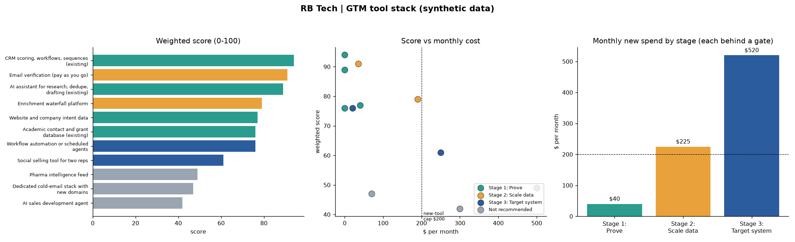
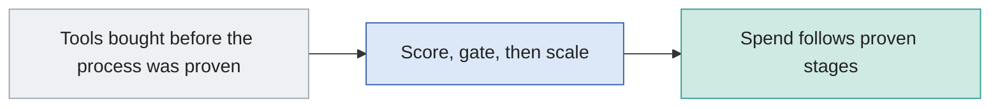

# 06 | GTM Tool Stack: Evaluate, Gate, Then Scale

**Fictional company:** RB Tech · **All data is synthetic** · Prices are invented, tools shown by category



## At a glance


## The story in STAR
- **Starting point:** Nothing existed for this yet, so I set it up from scratch.
- **Situation:** Tools promised more leads, each looked cheap, and none was proven.
- **Task:** Spend within a hard cap and only on proven bottlenecks.
- **Action:** Scored each tool, ranked them, and gated spend in three stages: prove, scale data, then target system.
- **Result:** Monthly new spend stays at $40, $225 and $520 across the stages, each behind a gate, and weak tools are marked not recommended.

## The problem
A crowded market of sales and marketing tools promises more leads, and each looks cheap on its own. Buying them one by one adds cost, overlapping features, extra places to keep data, and no proof that any single tool solved a bottleneck. The constraint here was a small team with a hard cap on new tool spend.

## Method
1. **Name the bottleneck first** (who to contact, when, data coverage, rep capacity, message). A tool earns a place only if it relieves a measured limit.
2. **Score every option on the same weighted criteria** ([docs/evaluation_criteria.md](docs/evaluation_criteria.md)): solves a measured bottleneck (30), data quality (20), CRM integration (15), cost (15), effort to run (10), risk (10).
3. **Use what is already paid for first.** The CRM's scoring, workflows and sequences, an AI assistant for research and drafting, and an existing contact database cover a large share of the engine at no new cost.
4. **Release spend in stages behind gates** ([docs/stage_gates.md](docs/stage_gates.md)): each stage starts only when the previous stage's evidence supports it.
5. **Write down what is not recommended and why**, and the condition that would change the answer.

## Result (synthetic)
| Stage | Gate to start | Adds | New spend per month |
|---|---|---|---|
| 1 Prove | Now | Existing tools plus website and company intent data | about $40 |
| 2 Scale data | Targeted reply rate at least 1%, and data is the limit | Enrichment platform, pay-as-you-go email verification | about $225 |
| 3 Target system | Pipeline growing per lane, credits fully used, budget approved | Social selling for two reps, scheduled automation | about $520 |
| Not recommended | | Dedicated cold-email stack, AI sales agent, pharma intelligence feed | Revisit only if numbers change |

Highest weighted scores went to the existing CRM, the verification step and the AI assistant, which is why the design starts with them.

## The system the tools serve
The tools plug into one architecture with three engines and one CRM as the source of truth: [diagrams/target_system.md](diagrams/target_system.md).

## Design decisions
1. **One CRM as the single source of truth.** Tools feed it through reviewed imports, not automatic syncs, until the data rules are proven.
2. **Who writes to the CRM is agreed in writing**: imports tagged by source, lifecycle and score written only by CRM workflows.
3. **No overlap.** One tool per stage of the funnel.
4. **Send only from the CRM**, so reply tracking, suppression and unsubscribe are in one place.
5. **Spend follows evidence.** Stage gates stop tool sprawl.

## Documents and diagrams
- [docs/evaluation_criteria.md](docs/evaluation_criteria.md) · [docs/stage_gates.md](docs/stage_gates.md)
- [diagrams/target_system.md](diagrams/target_system.md)

## Reproduce
```bash
pip install pandas numpy matplotlib
python scripts/tool_stack.py    # writes data/*.csv and charts/tool_stack.png
```

## Skills shown
Tool evaluation and selection · build-versus-buy thinking · budget governance · systems architecture · stage-gated investment · GTM operations
